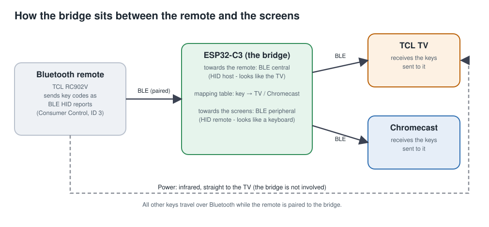
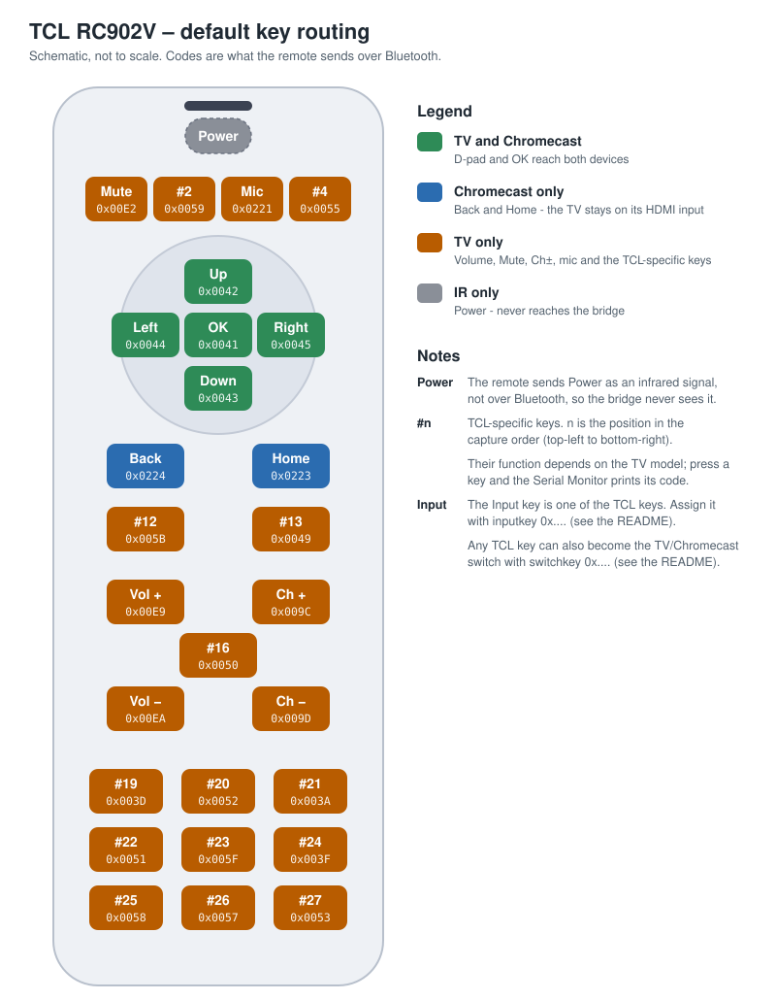

# BLE Remote Bridge

**Use one Bluetooth remote to control a TV *and* a Chromecast, with a different action per button.**
ESP32-C3 firmware (Arduino) that sits between a Bluetooth LE remote and your Android/Google TV devices.


<p align="center">
  
</p>

---

## The problem

A Bluetooth remote pairs with **one** device. If your Chromecast is plugged into an HDMI input of your TV you end up with two remotes, or with one remote that does the wrong thing:

* Press **Back** or **Home** on the TV's own remote while watching the Chromecast and the TV **leaves the HDMI input**.
* Press **Left/Right** on an HDMI input and the TV changes the **volume** instead of moving through the Chromecast menu.
* There is no way to say "this button is for the TV, that one is for the Chromecast".

## What this project does

The ESP32-C3 plays two roles at once:

* towards the **remote** it behaves like a TV: it pairs with the remote and receives every key press;
* towards the **TV and the Chromecast** it behaves like a Bluetooth remote: it is paired with both and sends them key presses.

In between sits a **mapping table** that you control. For every button you decide what the **TV** receives and what the **Chromecast** receives: the same key, a different key, or nothing.

**Features**

* One remote, two devices, per-button routing (TV only, Chromecast only, both, or neither).
* Change any mapping live from the Serial Monitor. Changes are saved and survive a restart.
* **Input session**: pressing the remote's *Input* button hands the arrows/OK/Back to the TV for a few seconds so you can pick an input, then gives them back to the Chromecast automatically.
* **Switch button**: a button of your choice toggles "TV mode" and back (with an automatic return).
* Press and release are forwarded separately, so holding Volume or an arrow behaves like the original remote.
* Pairings and settings are stored in flash; the bridge reconnects by itself after a restart.
* Prints the code of every button you press, which makes building your own mapping easy.

## Hardware and software

| | |
|---|---|
| **Board** | ESP32-C3 (developed on an *ESP32-C3 SuperMini*). Needs BLE; any ESP32-C3 board with USB should work, but only the SuperMini has been used. |
| **Remote** | TCL **RC902V** Bluetooth/IR remote (the key table is for this remote; see [Using another remote](docs/adapting-to-other-remotes.md)). |
| **TV / Chromecast** | Developed with a TCL C645 and a Chromecast with Google TV (4K, the first model). Any Android/Google TV device that accepts Bluetooth accessories is expected to behave similarly, but this is unverified. |
| **Arduino core** | `esp32` by Espressif Systems **3.3.12** (board: *ESP32C3 Dev Module*, **USB CDC On Boot: Enabled**) |
| **Library** | **NimBLE-Arduino 2.5.1 with the patch in [`library-patch/`](library-patch/README.md)** |

> **Why a patched library?** NimBLE-Arduino 2.5.1 writes past the end of a table when the Bluetooth radio hands out connection number 4, which happens while pairing the third device. On the author's board this crashed the ESP32 in a reboot loop. The patch is small, applies in one command, and the sketch refuses to compile without it. Details in [`library-patch/README.md`](library-patch/README.md).

## Quick start

1. **Install the tools.** Arduino IDE 2.x (or `arduino-cli`), then in *Boards Manager* install **esp32 by Espressif Systems, version 3.3.12**.
2. **Install the patched NimBLE-Arduino.** Easiest: download `NimBLE-Arduino-2.5.1-bridgefix.zip` from the [Releases](https://github.com/ItisMoe/ble-remote-bridge/releases) page, delete any existing `NimBLE-Arduino` folder from your Arduino `libraries` folder, and unzip it there. To patch the stock library yourself instead, see [`library-patch/README.md`](library-patch/README.md).
3. **Open the sketch** `firmware/ble_remote_bridge/ble_remote_bridge.ino`. The file `build_opt.h` next to it must stay in the same folder (it appears as a second tab).
4. **Select** *Tools → Board → ESP32C3 Dev Module* and *Tools → USB CDC On Boot → Enabled*, then upload. Open the Serial Monitor at **115200 baud**, line ending **Newline**.
5. **Before pairing**, remove old entries on the TV and the Chromecast (*Settings → Remotes & Accessories*): an old "Relay Test", and (recommended) on the TV the remote itself, so the TV does not try to reconnect to it.
6. **Pair the remote.** The bridge starts in remote-pairing mode on its first boot. Hold the remote next to the board and put it in pairing mode (RC902V: hold **OK + Home** for 3 s). Wait for `REMOTE PAIRED`.
7. **Pair the TV.** Type `pair tv`, then on the TV open *Remotes & Accessories → Pair accessory* and choose **Relay Test**. Wait for `TV PAIRED`.
8. **Pair the Chromecast.** Type `pair cc` and do the same on the Chromecast. Wait for `CHROMECAST PAIRED`.
9. **Check.** Type `status`. The remote, TV and Chromecast should all show as connected.

<details>
<summary>What the Serial Monitor shows while pairing (addresses anonymised)</summary>

```
=== BLE REMOTE BRIDGE v0.9.0 ===  NimBLE-Arduino 2.5.1 + bridge fix  (storage: 8 pairings, 32 subscriptions)
...
>> REMOTE PAIRING (2 min): hold the RC902V next to the board and hold OK + Home for 3 s.
Found 'TCL_RC902V_MH' at aa:bb:cc:dd:ee:01 (RSSI -43) - connecting...
Connected - pairing...

>> REMOTE PAIRED: aa:bb:cc:dd:ee:01
   Report map matches the RC902V capture, PnP ID matches
Remote ready

>> TV PAIRING (3 min): on the TV go to Settings > Remotes & Accessories > Pair accessory,
   select "Relay Test". (If it was paired before, remove it there first.)
   The remote is paused until pairing finishes.
Device aa:bb:cc:dd:ee:02 connected on connection 1 - waiting for it to pair/secure...
  [conn 1] not paired yet: sent the RIGHT key report of the two-host test (ok)
  [conn 1] pairing/encryption finished: OK (status 0)

>> TV PAIRED: aa:bb:cc:dd:ee:02
TV connected
Remote ready
Key 0x0045 Right -> TV 0x0045 | Chromecast 0x0045
```

</details>

Pairing the TV and the Chromecast can need a second try: if the Chromecast hangs on "pairing", wait a few seconds and try again (see [Troubleshooting](docs/troubleshooting.md)).

## Default key mapping

<p align="center">
  
</p>

> The picture is a **schematic**, not a scale drawing. Keys named `#n` are the TCL-specific keys: *n* is the order in which the key appeared when the remote was captured (top-left to bottom-right). The **Power** key is infrared only and never reaches the bridge.

| Button(s) | Codes | TV | Chromecast |
|---|---|:-:|:-:|
| Up, Down, Left, Right, OK | `0x0042`, `0x0043`, `0x0044`, `0x0045`, `0x0041` | ✅ | ✅ |
| Back, Home | `0x0224`, `0x0223` | – | ✅ |
| Mute, Vol+, Vol-, Ch+, Ch-, Assistant/Search | `0x00E2`, `0x00E9`, `0x00EA`, `0x009C`, `0x009D`, `0x0221` | ✅ | – |
| 14 TCL-specific keys (#2–#27, see the picture) | `0x0059`, `0x0055`, `0x005B`, `0x0049`, `0x0050`, `0x003D`, `0x0052`, `0x003A`, `0x0051`, `0x005F`, `0x003F`, `0x0058`, `0x0057`, `0x0053` | ✅ | – |
| Power | infrared, not Bluetooth | IR | – |

Back and Home go only to the Chromecast on purpose: the TV stays on its HDMI input. The full list with every code is in [docs/key-codes.md](docs/key-codes.md).

## Customising the mapping

Every change is one line in the Serial Monitor, takes effect immediately and is saved:

```
set <button> <what the TV gets> <what the Chromecast gets>
```

For each device you can give `same` (the button's own code), a code from the [key-code table](docs/key-codes.md), or `-` (nothing). Press a button to see its code in the Serial Monitor: `Key 0x0059 TCL key #2 -> TV 0x0059 | Chromecast -`.

| You type | Result |
|---|---|
| `set 0x0059 0x0224 -` | this key acts as **Back on the TV only** |
| `set 0x0221 0x0223 -` | the mic key acts as **Home on the TV only** |
| `set 0x0055 - 0x00CD` | this key is **Play/Pause on the Chromecast only** |
| `set 0x0044 - same` | Left goes to the **Chromecast only** (stops the TV changing volume on an HDMI input) |
| `set 0x0059 - -` | the key **does nothing** |
| `del 0x0059` / `defaults` | back to the original behaviour of one key / of every key |

More recipes, ready to paste, are in [docs/mapping-guide.md](docs/mapping-guide.md) and [`examples/`](examples/).

## Use cases

**1. Chromecast on an HDMI input (the default).** Arrows and OK reach both devices, Back and Home go to the Chromecast only, volume and the TV keys go to the TV. The TV never leaves the HDMI input by accident.

**2. One remote, one screen, for people who are not technical.** Send *everything* that navigates to the Chromecast, keep only Volume/Mute on the TV, and switch off every key that could take the TV somewhere else. Nobody has to remember which device they are controlling. The command list is in [examples/one-screen-simple.txt](examples/one-screen-simple.txt).

**3. Switching inputs with the remote's own Input key.** See the next section.

**4. Back/Home for the TV on spare keys.** If you sometimes need the TV's own Back or Home, give them to two keys you never use: `set 0x0059 0x0224 -` and `set 0x0221 0x0223 -`.

**5. Media keys for the Chromecast.** Map spare keys to Play/Pause (`0x00CD`), Rewind (`0x00B4`), Fast-forward (`0x00B3`), Next (`0x00B5`)... with `set <key> - <code>`.

**6. Another Android/Google TV device.** Another device that accepts a Bluetooth HID remote should be able to take the second slot instead of a Chromecast (untested).

## Input session and switch button

Because the TV never tells a Bluetooth remote which input it is showing, the bridge cannot know whether you want the arrows to move the TV's menu or the Chromecast. Two features cover this without guessing:

* **Input key.** Assign it once with `inputkey 0x....`. Pressing it opens the TV's input menu as usual and starts a **TV session**: arrows, OK and Back go to the TV only. The session ends when you press **OK**, or after **5 seconds** without an arrow/OK/Back press; then everything returns to the table.
* **Switch key.** Assign a key you never use with `switchkey 0x....`. Each press toggles **TV mode** (arrows, OK, Back to the TV only) and back. TV mode returns to normal by itself after **60 seconds** without any button press, so it can never be left "stuck".

```
inputkey 0x00XX      the remote's Input key (press it to read its code)
switchkey 0x00YY     a key you never use
tvsession 8          session timeout in seconds (1-60, default 5)
tvmode 120           TV-mode auto-return in seconds (0 = never, default 60)
```

The Input key's own code is sent to the TV, so this relies on the TV acting on that code (see the TCL-key item under [Limitations](#limitations)). State diagrams are in [docs/how-it-works.md](docs/how-it-works.md#tv-session-and-tv-mode).

## Limitations

* **Voice does not work through the bridge.** The bridge forwards key codes only. The mic key's *press* is forwarded (Assistant opens on the TV), but the microphone audio stream from the remote is not relayed.
* **Power is infrared.** The remote sends Power by IR, so it never reaches the bridge and the bridge cannot wake a TV from standby.
* **Vendor-specific keys.** Keys outside the standard set (the TCL-specific keys, streaming-service shortcuts) are interpreted by each device using its own key layout. They may do nothing on a Chromecast. Whether the TV acts on the TCL-specific keys with the bridge's default Bluetooth IDs is **not yet verified** (see [Project status](#project-status)).
* **Three Bluetooth connections only:** the remote, the TV and the Chromecast. A third device that tries to pair is rejected.
* **Pairing is "Just Works"** (bonded, secure connections, no passkey). While a TV/Chromecast slot is free, any nearby device that asks to pair could take it. Once both slots are filled, further devices are rejected.
* **Pinned versions.** Built and tested with esp32 core 3.3.12 and NimBLE-Arduino 2.5.1 only.

## Using another remote

The firmware is written for the RC902V's report format: a *Consumer Control* HID report with **Report ID 3** whose first two bytes are a little-endian 16-bit usage code, and all zeros for "released". The [remote sniffer](tools/remote_sniffer/remote_sniffer.ino) shows what any other remote sends, and [docs/adapting-to-other-remotes.md](docs/adapting-to-other-remotes.md) lists the few constants to change. Remotes with a different report layout need more work.

## Project status

This is a **beta (0.9.0)**. What has been verified on the author's hardware (ESP32-C3 SuperMini, TCL RC902V, TCL C645, Chromecast with Google TV 4K) and what has not:

| Area | Status |
|---|---|
| Pairing the remote, reading its report map, capturing every key | ✅ verified |
| Pairing the TV | ✅ verified on earlier builds; re-check on 0.9.0 (key-report timing changed, see [testing](docs/testing.md)) |
| Pairing the Chromecast (the third device) | ✅ verified (needed a retry once) |
| No crash/reboot loop with three devices (patched library) | ✅ verified |
| Key presses forwarded to the TV | ✅ verified |
| TV reconnects after the ESP32 restarts | ✅ verified |
| Key presses arriving at the Chromecast | ✅ verified |
| Remote reconnecting after it sleeps or after an ESP32 restart | ✅ verified |
| Chromecast reconnecting after a restart; TV standby cycle | ✅ verified |
| TCL-specific keys working on the TV with the default IDs | ✅ verified |
| Input session and switch key (new in 0.9.0) | ✅ verified |

The full test checklist and how to report results is in [docs/testing.md](docs/testing.md). The bugs found along the way, with evidence, are in [docs/development-notes.md](docs/development-notes.md).

## Repository layout

```
firmware/ble_remote_bridge/   the bridge firmware (.ino + build_opt.h)
library-patch/                the NimBLE-Arduino patch and how to apply it
tools/remote_sniffer/         diagnostic: reads any remote's report map and key codes
tools/two_host_test/          diagnostic: the TV/Chromecast half on its own
tools/apply_mapping.py        optional helper to send a mapping file over serial
examples/                     paste-ready mapping files
docs/                         command reference, mapping guide, key codes, how it works, ...
```

## Documentation

* [Command reference](docs/commands.md)
* [Mapping guide](docs/mapping-guide.md)
* [Key codes](docs/key-codes.md)
* [How it works](docs/how-it-works.md)
* [Using another remote](docs/adapting-to-other-remotes.md)
* [Troubleshooting](docs/troubleshooting.md)
* [Testing and project status](docs/testing.md)
* [Development notes (bugs and evidence)](docs/development-notes.md)
* [Changelog](CHANGELOG.md)

## Acknowledgements

Built on [NimBLE-Arduino](https://github.com/h2zero/NimBLE-Arduino) by h2zero (Apache-2.0), which wraps the NimBLE Bluetooth stack, and the Arduino core for ESP32 by Espressif Systems.

## License

MIT, see [LICENSE](LICENSE). The patch in `library-patch/` modifies NimBLE-Arduino and stays under that project's Apache-2.0 license (see [library-patch/README.md](library-patch/README.md)).
