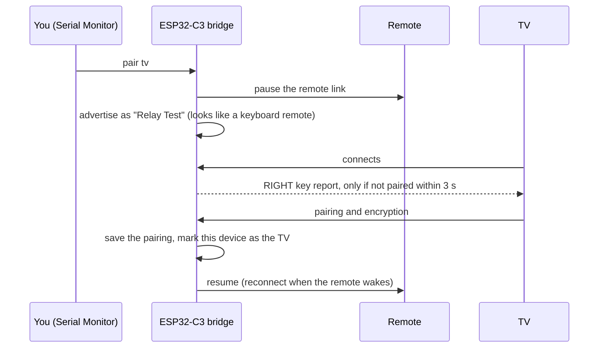
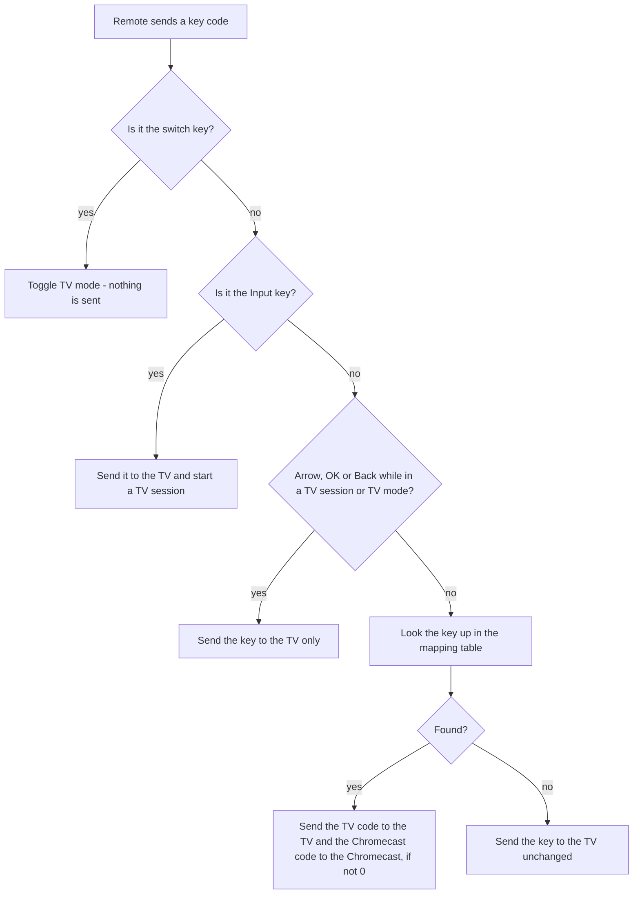
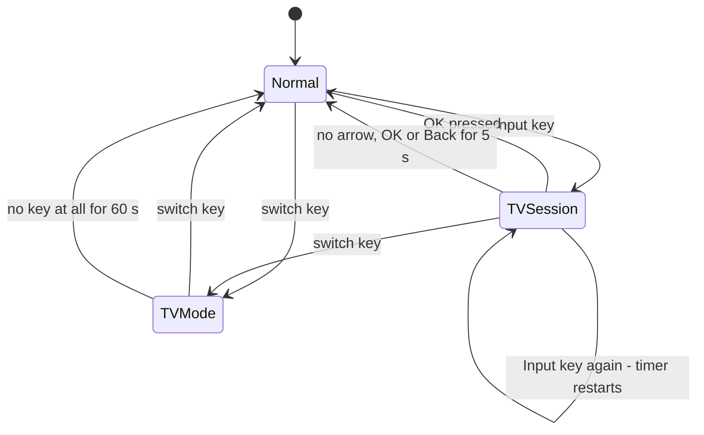

# How it works

This page explains what the firmware does, step by step. For the problem it solves and a quick start, see the [README](../README.md).

## Two roles on one radio

Bluetooth LE has two sides of a connection. The ESP32-C3 takes **both** at the same time:

| Towards | Role of the ESP32-C3 | What it looks like | Bluetooth role |
|---|---|---|---|
| the **remote** | HID *host* | the TV | **central** (it connects to the remote) |
| the **TV** and the **Chromecast** | HID *device* | a Bluetooth remote ("Relay Test") | **peripheral** (they connect to it) |

That is three simultaneous connections: remote, TV, Chromecast. The sketch checks at compile time that the library is configured for at least three connections and (through `build_opt.h`) room for 8 pairings and 32 subscriptions, and that the patched library is installed.

## Pairing

Each device is paired once and then recognised by its saved pairing keys, even when Android changes its visible Bluetooth address. Pairings are stored in flash by the Bluetooth library; your mapping and settings are stored separately.

Notes:

* `pair tv` and `pair cc` **pause the remote** while pairing, so the radio does exactly what it did in the [two-host test](../tools/two_host_test/two_host_test.ino) that is known to pair with the TV.
* If a connected device has not paired within 3 seconds, the bridge sends it the same RIGHT key report the two-host test sends. In the author's tests the TV paired after receiving it and did not pair without it. The bridge sends it again every 15 seconds until the device has paired. Whether the report is really what the TV was waiting for was not proven; see [development notes](development-notes.md#the-tv-connects-but-never-pairs).
* A device is only saved as the TV or the Chromecast after pairing **finished successfully and its keys were stored**. A failed attempt saves nothing, so the device can simply try again.
* If you start the TV or Chromecast without typing `pair tv` / `pair cc` first, a new device takes the free slot (TV first). `swap` exchanges the two.
* A third device that pairs is rejected and its pairing is deleted.

## What happens when you press a button

The remote sends a Consumer Control report: two bytes with a 16-bit code, and all zeros when the button is released. The bridge decides where it goes:

* The **release** is sent to exactly the devices that received the press, so holding a key behaves like the original remote.
* A different key pressed while one is held first releases the old one.
* If the remote disconnects, any held key is released on the TV and the Chromecast, so a key can never stay "stuck".
* The TV gets the report in the same 6-byte format the remote itself uses; the Chromecast gets the 2-byte form the report map declares.

## TV session and TV mode

Both exist because the TV never tells a Bluetooth remote which input it is showing, so the bridge cannot know whether the arrows should move the TV's menu or the Chromecast.

| State | Arrows, OK, Back go to | Everything else |
|---|---|---|
| **Normal** | whatever the mapping table says | mapping table |
| **TV session** | the TV only | mapping table |
| **TV mode** | the TV only | mapping table |

The two timeouts are settings: `tvsession <seconds>` and `tvmode <seconds>` (see the [command reference](commands.md)). The switch key is never sent to any device.

## Reconnecting

* **Remote.** The bridge keeps a connection attempt to the saved remote open with no time limit, so as soon as the remote wakes up and advertises (you press a button) it connects. The first press after a long sleep can therefore take longer.
* **TV and Chromecast.** The ESP32 advertises whenever fewer than two of them are connected, so they can reconnect by themselves after a restart or standby. While they are reconnecting after boot (up to 15 s) and while one is connecting or pairing, the bridge does not listen for the remote, to keep the radio free.

## Report format and the Android key path

The bridge presents two input reports to the TV and Chromecast: a **keyboard** report (ID 1, identical to the one in the two-host test) and the remote's own **consumer** report (ID 3). All button traffic uses the consumer report; the keyboard report exists to match the profile that is known to pair.

Android turns a consumer-page usage into a key event through the Linux HID driver and a key-layout file, which is why only a standard set of codes (see [key codes](key-codes.md)) works on every device, while vendor-specific codes depend on the receiving device.

## What is stored where

| Data | Where | Erased by |
|---|---|---|
| Pairing keys (remote, TV, Chromecast) | Bluetooth library store in flash | `forget`, `factory yes`, hold BOOT 5 s |
| Which pairing is the TV / Chromecast / remote | flash settings | `forget`, `factory yes`, hold BOOT 5 s |
| Mapping table, Input/switch keys, timeouts, IDs | flash settings | `factory yes` (hold BOOT keeps them) |

## Security

Pairing uses LE Secure Connections with bonding but **no passkey** ("Just Works"). While a TV/Chromecast slot is free and the bridge is advertising, a nearby device could pair into it. Once both slots are filled, additional devices are rejected and their pairing is deleted. Keep the bridge out of reach during first-time pairing, and pair the TV and Chromecast promptly.
